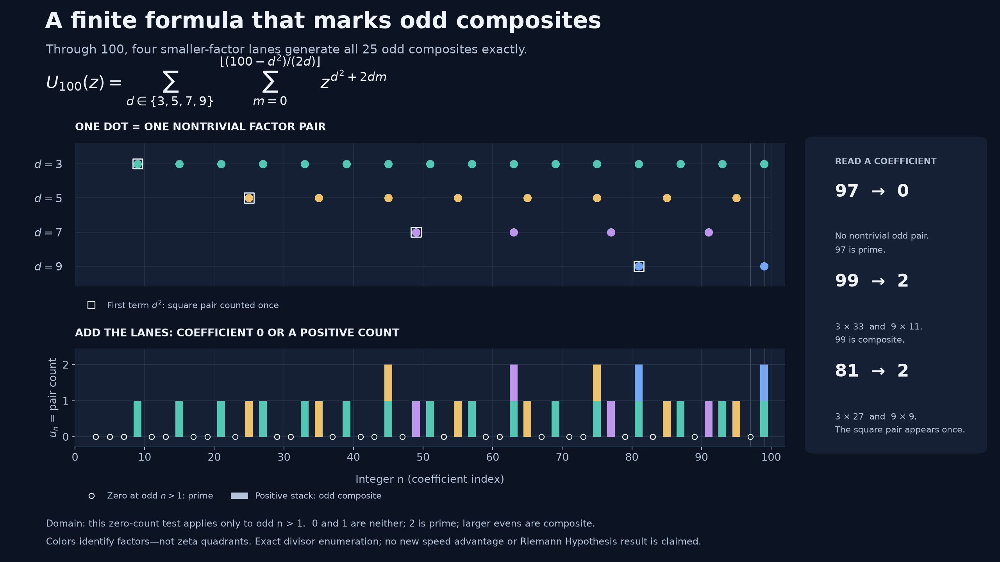

# A finite formula that marks odd composites

defines: graph.primes.composite_remainder.documentation

The finite construction works exactly. Start with all odd factor pairs, remove the two families involving the factor 1, and restore their overlap (1,1). What remains has a positive coefficient exactly at the odd composites. Counting unordered pairs makes the finite computation smaller.



For an odd integer n>1, the direct coefficient is

\[
D(n)=\sum_{\substack{3\le d\le\lfloor\sqrt n\rfloor\\d\text{ odd}}}
\left(\left\lfloor n/d\right\rfloor-\left\lfloor(n-1)/d\right\rfloor\right).
\]

It equals zero exactly at odd primes, and is positive exactly at odd composites. Examples: D(81)=2, D(97)=0, D(99)=2. These are coefficients indexed by n, not values obtained by plugging n into a zeta function. The complete implementation separately handles 0,1,2 and even integers.

## What was tested

`run_experiment.py` checked every integer 0..100000 against an independent sieve, compared three equivalent constructions, tested the floor formula, checked square boundaries and prefix consistency, rejected invalid input types, and tested larger individual controls. All 100001 classifications passed. The small-range command with `--limit 100` also passed.

The 0..100 figure has four smaller-factor lanes: 3,5,7,9. Their 30 contributions cover all 25 odd composites. The 24 odd primes have zero coefficients; 2 is handled separately. Lane colors identify factors, not zeta quadrants.

An independent reviewer additionally checks the arithmetic against multiplicative divisor counts from factorization and reviews the [all-integer proof](proof.md). Detailed observations are in `evidence/`. The figure is checked separately in `figures/figure-review.json`.

## What this does not establish

The candidate functions take no prior-prime list as input. They still perform divisor work: directly computing D(n) checks the odd candidates through sqrt(n). The finite batch construction is a divisor sieve. The local benchmark favored the conventional prime sieve; its optimized bytearray operations differ from the Python loops used for coefficient generation, so the timing is not an algorithmic lower bound or universal comparison.

Bare finite reversal does not produce this remainder. Forward-minus-reversed coefficients are antisymmetric; a nonzero composite indicator has nonnegative coefficients. The [proof](proof.md) states the precise scope of that obstruction and includes the separate zeta/Dirichlet representations and their convergence domains. No new primality algorithm, instantaneous decision, novelty claim, or RH advance is established.

## Run from the repository root

The arithmetic uses the Python standard library. Recorded tests use Python 3.11.5.

```powershell
python research/composite-remainder/run_experiment.py
python research/composite-remainder/run_experiment.py --limit 100 --output work/composite-small
```

For a single candidate, import `odd_coefficient`, `factor_pairs`, and `classify` from `composite_remainder.py`; no data files or prime list are required. `classify(96)` is composite through the even-number guard, `classify(97)` is prime through coefficient zero, and `factor_pairs(99)` is `[(3,33),(9,11)]`.

The optional figure renderer requires Matplotlib and NumPy. Its source and input hashes are recorded in `figures/render-report.json`.

Recur Warp/trace prefix: `graph.primes.composite_remainder`. This lane follows the user's direction to implement and test directly after three external Carbon checkpoints. Carbon suggested the unordered factor series; the subtraction proof, implementation, reversal test and acceptance are independently checked. Prior accepted animations and graphics remain unchanged.
