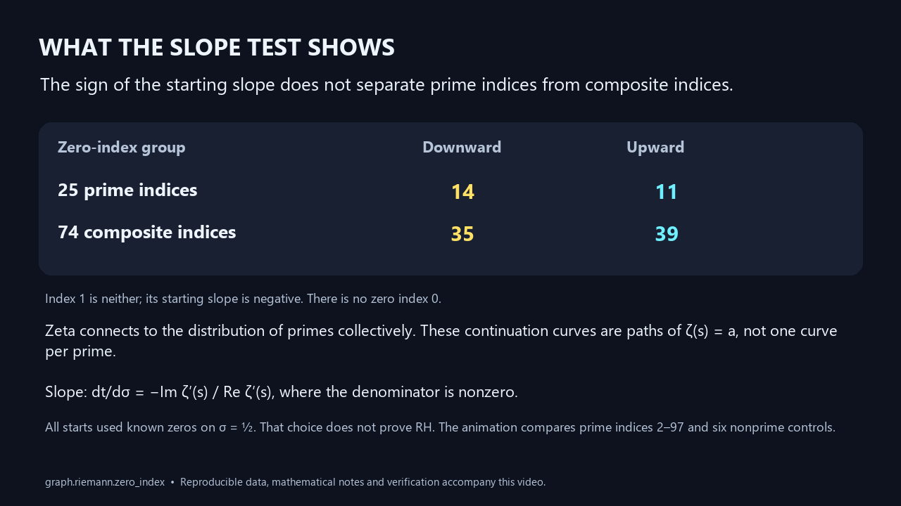

# What the zeta-path slope comparison shows

defines: graph.riemann.zero_index.documentation

The sign of the initial slope does **not** identify whether a zero's index is prime. Among the first 100 positive-height nontrivial zeros, 14 prime indices have negative initial slopes and 11 have positive slopes. Composite indices give 35 negative and 39 positive slopes. Index 1 is neither and has a negative slope.

The 84-second, silent [animation](media/zero-index-slope-tour.mp4) revisits the original three paths, then compares every prime zero index through 100 and six nonprime controls. All panels show the zero index, its actual noninteger height, and its starting slope at sigma=1/2. There is no zero index 0. The controls are indices 1, 4, 6, 8, 9 and 10.



## Meaning of the graphics

`Zero #3` denotes the third zero, starting near `0.5 + 25.0108575801 i`. It does not denote the integer 23, the prime 3, or the third prime. The moving paths solve `zeta(s)=a` as the real target `a` increases. At positive `a`, they are zeros of `zeta(s)-a`, not zeros of zeta itself.

The initial tangent follows `ds/da = 1/zeta'(s)`, hence `dt/dsigma = -Im(zeta'(s))/Re(zeta'(s))` when the denominator is nonzero. At a simple critical-line zero this also equals `-cot(theta(t))`, using the established Hardy Z phase relation. See [the derivation and numerical limits](proof-notes.md).

The background is the quadrant of `zeta(s)-a`; pink is the selected trajectory's annotation in every local scene. All local panels use identical scales, with vertical coordinates measured relative to that zero's starting height. The dashed white line is the initial tangent. Moving dots interpolate independently checked solution samples; intermediate display positions are not independently solved roots.

Near-zero background values with magnitude below `1e-10` are drawn neutrally. Phase is undefined at an exact zero, and double-precision color choices near zeros or axes are unstable. The mask is a display convention, not a certified error bound. Native raw diagnostic PNGs use their recorded original palette; the movie recolors the binary values and applies the neutral mask.

The intro uses the historical three paths through `a=1`. Its held exit boxes retain the last in-window point and are explicitly not current roots. The new local paths only cover `a=0..0.10`.

## Verification

- Native Graphics build: zero errors, nine existing warnings.
- Independent high-precision review: 100 starting zeros and derivatives, the Hardy phase identity, 651 saved path points, and 31 additional half-step solutions.
- Native grid review: all 3,104,000 nodes finite; 160 audit points and 64 sampled binary nodes compared with high-precision zeta. Largest observed native absolute error was below `3.14e-13`.
- Largest independently recomputed residual at the saved path coordinates was below `2.10e-45`. The producer's smaller internal residuals use coordinates before serialization and are not the same measurement.
- Visual review and encoded-video checks are recorded separately in `evidence/`. These checks do not constitute interval enclosures, a certified continuation tube, or an RH proof.

All starts were chosen from known zeros on the critical line. Their selection cannot establish that every nontrivial zero lies there. No novelty, primality algorithm, or prime-generation speedup is claimed. This is a reproducible test of a proposed visual pattern, including counterexamples.

The actual prime connection is collective: [Euler's product for zeta](https://dlmf.nist.gov/25.2.E11) is valid for Re(s)>1. Individual primes are its factors, not labels for these continuation curves. The critical-line phase relation is given in [DLMF 25.10](https://dlmf.nist.gov/25.10).

## Reproduce from the repository root

Use Python with mpmath 1.3.0 for the mathematical producer/reviewer. The original successful math run used Python 3.11; its exact runtime is recorded in the evidence. Rendering additionally requires NumPy, Pillow, imageio-ffmpeg and the Windows Segoe UI fonts. Graphics currently targets .NET 5 Windows; the recorded run used the installed .NET SDK/runtime with major roll-forward.

```powershell
python research/zeta-zero-index/zero_index_analysis.py
dotnet build Graphics/Graphics.csproj -c Release -o work/zeta-zero-index/bin
$env:DOTNET_ROLL_FORWARD = 'Major'
$gridProcess = Start-Process -FilePath work/zeta-zero-index/bin/Graphics.exe -ArgumentList @('--zeta-zero-index-grids','research/zeta-zero-index/evidence/zero-index.json','work/zeta-zero-index/grids') -WindowStyle Hidden -Wait -PassThru
if ($gridProcess.ExitCode -ne 0) { throw 'Native grid export failed' }
python research/zeta-zero-index/verify_math_and_grids.py --grids work/zeta-zero-index/grids/grids.json --native-bin work/zeta-zero-index/bin
python research/zeta-zero-index/animate.py --grids work/zeta-zero-index/grids --output work/zeta-zero-index/movie
```

The mathematical producer writes its evidence files; reruns can have different runtime metadata and source hashes. Preserve the accepted original records before replacing them. Raw native grids are generated locally rather than stored in Git. Their metadata and hashes accompany the review. The movie, preview images, math data and verification reports are included in this lane.

Recur Warp and trace prefix: `graph.riemann.zero_index`. This lane is separate from the finite divisor/half-step comparison under `graph.primes.divisor_phases` and preserves the earlier full presentation unchanged.
